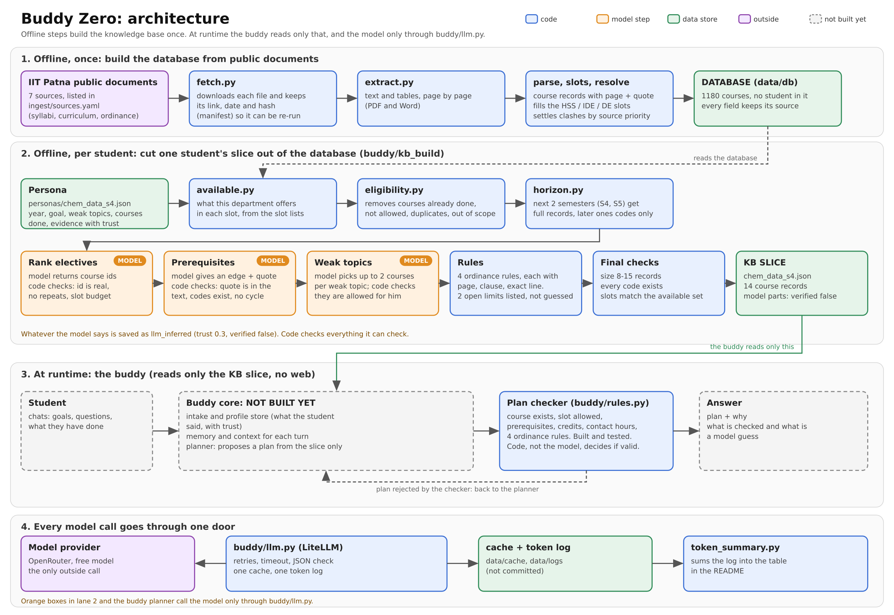

# Buddy Zero: a small learning buddy for IIT Patna

Buddy Zero helps one IIT Patna B.Tech student pick courses for the coming semesters.

I tested it on one made-up student: a 2nd-year Chemical Engineering student who must finish the normal
coursework, wants to build computing and data skills for process data and simulations, and is weak in maths.

The buddy reads only a small knowledge base (KB). While it runs, it never goes to the web. The only outside
call is to the model provider, and that goes through one file, `buddy/llm.py`.

## Read these first

| File | What it is |
|---|---|
| `data/demo/chem_data_s4.slice.json` | the KB the buddy reads for this student |
| `data/demo/chem_data_s4.review.md` | what the model chose for the KB, and why |
| `data/demo/chem_data_s4.decisions.jsonl` | every model decision, with code's verdict on it |
| `buddy/rules.py` and `tests/` | the rule checks and the tests that catch bad plans |
| `build_log.txt` | my build log, in my own words |
| `log.md` | the coding agent's run log: what it built, what broke, what it fixed |

## How it works

1. Download the public IIT Patna PDFs (`ingest/fetch.py`). Every source is listed in `ingest/sources.yaml`.
2. Extract the text, then turn it into course records (`ingest/extract.py`, `ingest/parse.py`).
3. Fill the slots (HSS, IDE, DE) and settle clashes between sources (`ingest/slots.py`, `ingest/resolve.py`).
   The result is the **database**: 1180 courses, no student in it (`data/db/`).
4. Read the persona, find what this student may actually take, and cut the database down to a **KB slice**
   (`buddy/kb_build/`). This is where code and the model work together.
5. The buddy loads the slice and nothing else.

The database holds every course. The KB holds only what one student needs.

## What code does and what the model does

The rule I followed: if the model can be wrong and code can check it, code checks it.

| The model | Code |
|---|---|
| ranks the elective options for this student | checks every course code exists |
| suggests prerequisites, with a quote from the course text | checks the quote is really in the text, and that there is no cycle |
| suggests courses that help with each weak topic | checks the course is allowed in that slot |
| | does all credit, contact-hour and rule checks |
| | decides if a plan is valid |

Anything the model says is stored as `llm_inferred`, trust 0.3, `verified: false`.
Facts that came straight from a source page are stored with trust 0.9 and the page, quote and link.

### In the recording dry run

Who answered each step of the recording script (first run, real model). "Code" means no model call and 0 tokens.

| Step | Answered by | Model calls | Seconds | Tokens |
|---|---|---|---|---|
| 1. Start with `--reset` | code | none | 0 | 0 |
| 2. Intake message | model | intake, choose | 47.6 | 3,564 |
| 3. `/profile` | code | none | 0 | 0 |
| 4. "what is rule 8.4(c)?" | code | none | 0 | 0 |
| 4b. `/tokens` | code | none | 0 | 0 |
| 5. Add MA2206 as an extra course | model | revise | 94.9 | 3,766 |
| 5b. "Can I also take Numerical Methods this semester?" | model | revise | 30.5 | 1,698 |
| 6. "Which of my courses covers Python and data analysis?" | model | route, answer | 4.2 | 504 |
| 7. `/quit`, restart without `--reset` | code | none | 0 | 0 |
| 8. `pytest -q` | code | none | 3.0 | 0 |

Code only: 6 of 10 steps, 0 model calls, 0 tokens. Model: 4 of 10 steps, 8 calls, 9,532 tokens.
Code still works inside the model steps: it routes the change request by course code, checks the change as asked
before any model proposal, and checks every plan the model proposes.

## The rules in the KB

All four are from the B.Tech Ordinance, each with page, clause and the exact line:
https://academics.iitp.ac.in/images/regulation/B.Tech_Ordinance_2019_onwards.pdf

- 8.4(a): pass all first-year courses before registering for third-year courses.
- 8.4(c): from semester 5, a student with CPI of at least 8.0 may take one extra course, with approval.
- 8.4(b): at most 32 contact hours per week.
- 12.1(a): CPI below 5.0 gives a warning, and two such semesters in a row may end continuation.

Two things I looked for and did not find on public pages: a per-semester credit limit on the new scale,
and who may take a Minor. They are listed in the slice as open limits, not guessed.

## Token use

Every model call is logged by `buddy/llm.py` (no keys, no full prompts) and summed by `scripts/token_summary.py`.

- 9 calls: 5 real, 4 answered from the cache, 0 failures.
- About 41,000 tokens in total (prompt plus completion), all on a free OpenRouter model.
- The biggest call was the prerequisite step (about 18,000 tokens), because the model writes a quote for each edge.

### Why two rank prompts appear in the table

**Why it happened:**
1. The first prompt (`rank_v1`) sent the keyword matches to the model as hints ("this course matched: artificial intelligence, python").
2. The first preview showed the hints might be steering the model. It put CS3106 Computer Graphics at #2 for an ML student, with the reason "practical introduction to machine-learning concepts". But "machine learning" appears nowhere in that course's text; the hint words "artificial intelligence" and "python" did. So the ranking might have been echoing the keyword hints instead of reading the courses.
3. To check, I wrote a version without hints (`rank_v2`) and ran one real call with each prompt on the new persona (`chem_data_s4`), side by side.

**What it cost:**
- v1: 4,750 tokens; v2: 5,023 tokens. About 9,800 of the 41,339 total.
- It's a free OpenRouter model, so it cost no money, only free-tier quota.

**What we learned:**
- The same top 5, in the same order, so the slice gets the same 4 courses either way. The hints weren't distorting the important part.
- v2 is a bit better on honesty. It says when it judged a course by title only (with one error, MA2207). v1 made up "lab course" for CH3106.
- So v2 became the default, and v1 is kept only for the record.

**From now on, only one version runs:**
- The builder uses just `rank_prompt_version: rank_v2` from `config/kb_build.yaml`, one rank call per build.
- Rerunning the same persona costs 0 tokens, because the answer comes from the cache. That's why the rebuild before the GitHub push showed `attempts: 0`.
- v1 is never called unless someone switches the config back.

**Was it worth it?** For the KB itself, no. For the submission, it gives one small piece of evidence: the prompt design was tested for bias, and the result is shown in `data/demo/chem_data_s4.rank_v1_vs_v2.md`. That's useful if a reviewer asks "how do you know the model isn't just echoing your keywords?"

Generated by `python3 -I scripts/token_summary.py` (averages count only real, successful calls):

<!-- token-summary:start -->
| prompt version | purpose | calls | cache hits | failures | avg prompt tokens | avg completion tokens |
|---|---|---|---|---|---|---|
| foundations_v1 | cache | 1 | 1 | 0 | - | - |
| foundations_v1 | first | 1 | 0 | 0 | 3665.0 | 1153.0 |
| prereq_v1 | cache | 1 | 1 | 0 | - | - |
| prereq_v1 | first | 1 | 0 | 0 | 4483.0 | 13633.0 |
| rank_v1 | first | 2 | 0 | 0 | 3514.5 | 3176.5 |
| rank_v2 | cache | 2 | 2 | 0 | - | - |
| rank_v2 | first | 1 | 0 | 0 | 2097.0 | 2926.0 |
| all | all | 9 | 4 | 0 | 3454.8 | 4813.0 |
<!-- token-summary:end -->

## What is checked, and what is not

- The slice has 14 full course records. Size, course-exists and slot-membership checks pass.
- 115 tests (last run). They include tests that reject made-up course codes and courses outside the allowed slot.
- Nothing in the slice is marked `verified: true` yet. I have not spot-checked it by hand.

## Honest limits

- Some courses have no description text. I only downloaded the syllabi of departments this student would
  realistically use. Courses from the others (for example HSS, Civil, Physics) have a code and title but no
  text. The model is told this and says so; code also flags them. A full system would hold all departments.
- The prerequisite check does not look at semester order. So it let through "MA2206 (sem 4) needs MA3107 (sem 5)".
- The quote check accepts very short quotes such as "ODE", which appear in the text but do not prove a dependency.
- The model once called a course a "lab course" with no text to support it. Code now drops that kind of claim
  when the course has no practical hours.
- The rules come from the 2019-onwards ordinance. I have not confirmed it is the latest one.
- Still to do: the buddy itself (profile store, planner, memory), and my own hand-check of the KB.
